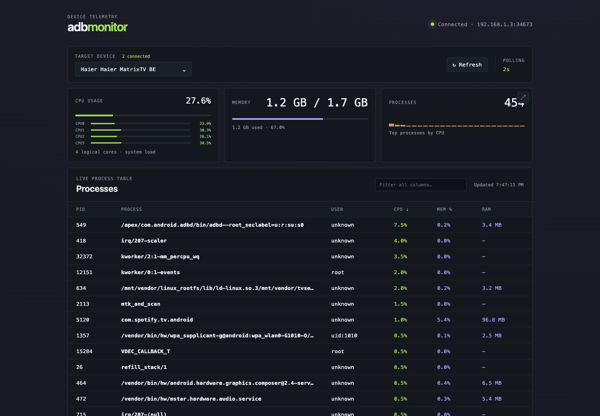
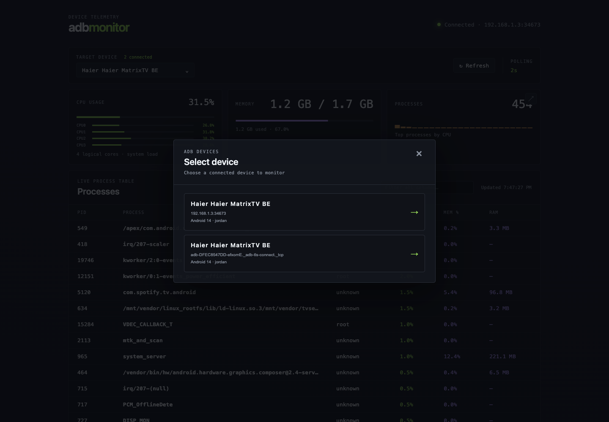
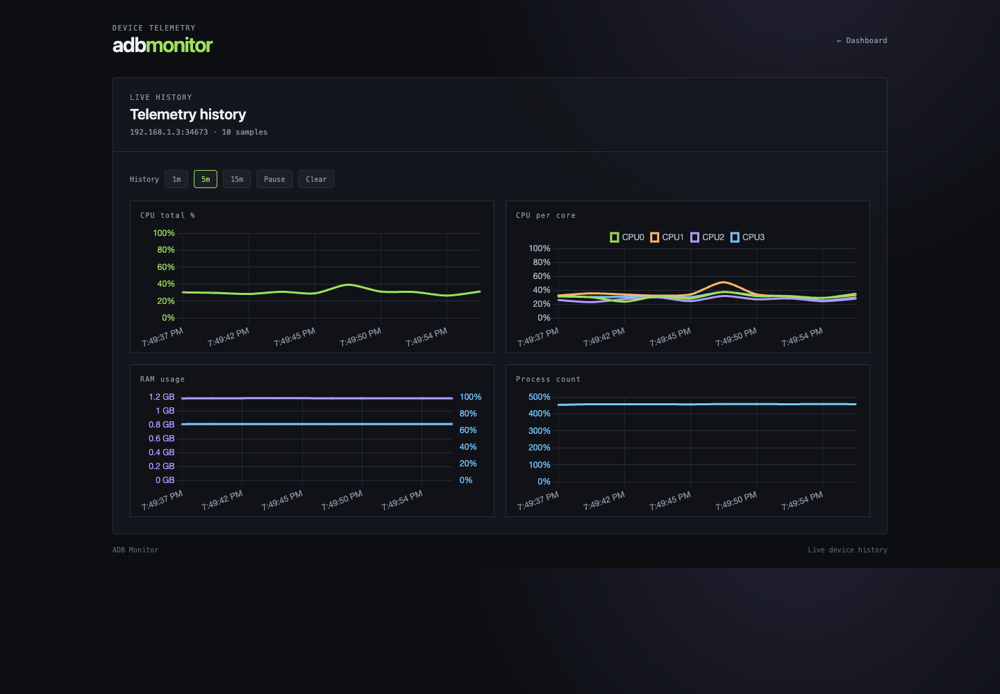
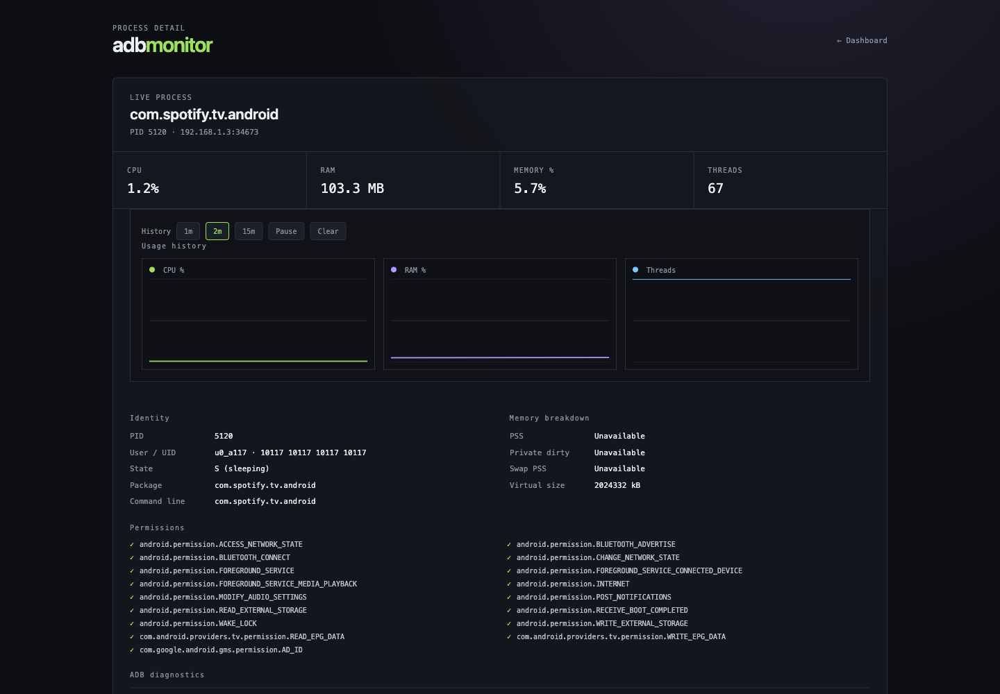

# ADB Monitor

An open-source, low-overhead Android device monitor with an htop-style web dashboard. It connects to any ADB device, streams live telemetry, and keeps the full process list visible—including the processes created by the monitor itself.



## Highlights

- Live CPU, per-core CPU, RAM, memory percentage, and process-count telemetry
- Lightweight `/proc` collection instead of repeatedly invoking `ps` or `dumpsys cpuinfo`
- Multiple-device support with a metadata-rich device picker
- Full process table with sortable columns, global filtering, numeric RAM values, and remembered view preferences
- Process detail pages with command line, executable, working directory, environment, threads, file descriptors, permissions, and ADB diagnostics when the device exposes them
- Separate historical charts for CPU, RAM, threads, total CPU, per-core CPU, RAM capacity, and process count
- Synced chart tooltips, selectable history windows, pause/resume, clear, modal views, and new-page views
- No Android app or agent required—the service uses the existing `adb` executable

## Screenshots

### Device picker

Connected devices are identified by serial, manufacturer, model, Android version, and product information.



### Telemetry history

The history page separates each metric into its own chart and supports synchronized hover inspection.



### Process diagnostics

Open any process from the table to inspect its live details and historical usage.



## Requirements

- Node.js 18 or newer
- Android Platform Tools (`adb`) on `PATH`
- One or more connected, authorized Android devices

Check connectivity before starting:

```sh
adb devices
```

## Quick start

```sh
git clone <your-fork-url>
cd tv-monitor
npm start
```

Open [http://localhost:3000](http://localhost:3000) in a browser. Use the device selector to choose a target when multiple ADB devices are connected.

For development with automatic server restarts:

```sh
npm run dev
```

## Configuration

The server accepts these environment variables:

| Variable | Default | Description |
| --- | --- | --- |
| `PORT` | `3000` | HTTP server port |
| `POLL_INTERVAL` | `2000` | Telemetry interval in milliseconds |

Example:

```sh
PORT=8080 POLL_INTERVAL=5000 npm start
```

A longer interval reduces ADB and device overhead. The dashboard receives updates over Server-Sent Events rather than opening a browser request for every sample.

## How collection works

The normal monitoring path reads Linux procfs files through `adb shell`:

- `/proc/stat` for total and per-core CPU deltas
- `/proc/meminfo` for memory totals and availability
- `/proc/<pid>/stat`, `/proc/<pid>/status`, and `/proc/<pid>/cmdline` for process metrics
- Additional `/proc/<pid>` files and standard Android properties for process diagnostics and device identity

The dashboard intentionally does not run `ps` during normal monitoring. A separate comparison endpoint is available for collector validation:

```text
/api/compare?serial=<device-serial>
```

The endpoint compares a lightweight procfs snapshot with `ps` output, including process counts, matched PIDs, and RSS differences. It is intended for diagnostics, not the live polling path.

## HTTP API

| Endpoint | Purpose |
| --- | --- |
| `GET /api/devices` | List connected ADB devices and identity metadata |
| `GET /api/stream?serial=...` | Stream live telemetry as Server-Sent Events |
| `GET /api/process?serial=...&pid=...` | Fetch detailed process diagnostics |
| `GET /api/compare?serial=...` | Compare procfs collection with `ps` |

## Project structure

```text
server.js                 HTTP server, ADB bridge, and collectors
public/index.html         Live dashboard shell
public/app.js             Dashboard interactions and process table
public/overview.html      History page shell
public/overview-page.js   History charts and controls
public/process.html       Process detail page shell
public/process-page.js    Process diagnostics and charts
public/styles.css         Shared dark UI styles
docs/screenshots/         README feature screenshots
```

## Permissions and limitations

ADB can only report what the connected device exposes to the shell user. Some fields—such as another process's environment, file descriptors, command line, or permission details—may be unavailable on production builds, restricted profiles, or non-root devices. Missing values are shown as unavailable rather than inferred.

The service is local by default and does not upload telemetry. If you bind it to a public interface or place it behind a proxy, add the authentication and network controls appropriate for your environment.

## Contributing

Issues and pull requests are welcome. When reporting a collector discrepancy, include the Android version, device model, ADB version, and a sanitized sample from `/api/compare` where possible.

## License

No license has been selected for this repository yet. Add a license before distributing forks or accepting external contributions.
